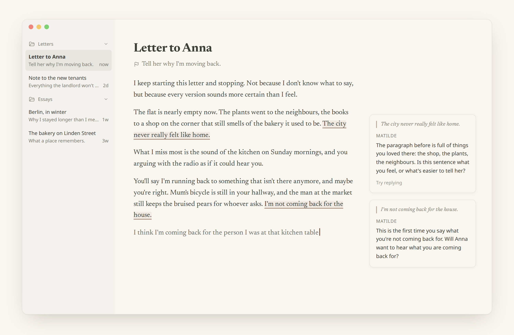

<div align="center">



# Matilde

**You write every word. Matilde reads along.**

A quiet writing app for the Mac that asks questions instead of writing for you.

[](https://matilde.page/download)
[](https://matilde.page)


<sub>macOS 14 or later · Apple silicon · <a href="https://github.com/gontsolov/matilde/releases/latest">Latest release</a></sub>

<br />
<br />

<picture>
  <source media="(prefers-color-scheme: dark)" srcset="docs/images/matilde-dark.png" />
  
</picture>

</div>

## What Matilde is

Matilde is a quiet writing app for the Mac. It reads along like a thoughtful editor: it asks questions and leaves notes in the margin. It won't write your paragraphs or make your decisions. The thinking stays yours.

- **A calm page.** Markdown renders as you type, with the symbols tucked away. Warm paper, a lovely serif, nothing blinking at you.
- **Plain files.** Your notes are ordinary Markdown files in a folder on your Mac. Open them anywhere, back them up however you like.
- **Try another version.** Branch a draft to try a different take, and keep both. Switch between them, lay them out on a board, or compare two side by side.
- **Notes in the margin.** Leave your own comments next to Matilde's. They follow their passage and never touch your text.
- **Ask Matilde.** When you want a second reader, Matilde reads the page and asks about it: is this sentence what you feel, or what's easier to say? You reply, think it through, and rewrite it yourself. Suggested changes only apply when you accept them.

## Why it exists

Matilde is a side project by [Filip](https://tsolov.zip). I built it because I believe AI can really help you write better, but not by writing for you. Most AI writing tools hand you a finished paragraph, and the result sounds like everyone else's. A good editor does something different: they challenge you, ask the awkward question and help you arrive at the conclusion yourself. That's what I wanted Matilde to be: a place for your own words, with a reader that makes them sharper.

## Sync between your Mac and iPhone

Sync is optional and off until you turn it on. Sign in with your email (no password), and your notes stay in step between your Mac and, soon, your iPhone.

- **Locked before it leaves.** Your notes are encrypted on your Mac before they're sent (end-to-end encryption). The key stays with you, so no one else can read your writing. The one exception is an AI tool you choose to connect (below).
- **Kept in the EU.** Synced notes are stored in the EU. The server sees your email address and how much you sync, never what you write.
- **Still plain files.** Sync works on top of your Markdown folder; nothing about your files changes.

## Works with your AI tools

If you like, connect an AI tool that supports MCP, such as Claude, ChatGPT or Cursor, to your synced notes through Matilde's MCP server:

```
https://mcp.matilde.page/mcp
```

The tool can then list, search and read your notes, leave comments in the margin (marked with its name), create notes and, only if you allow it, edit them. It can also send feedback about Matilde. You connect it on a Matilde page in your browser: sign in with your email, enter your Matilde key (it stays in your browser), choose what the tool may do and for how long (1 to 90 days). Disconnect it any time in Matilde's **Settings → Sync → Connected AI tools** on your Mac or iPhone.

It's off until you connect a tool, and it's a trade-off worth knowing: while a tool is connected, the Matilde server decrypts your notes in memory to answer it, and whatever the tool reads goes to the company behind it. Setup for each tool and the full details: [docs/mcp.md](docs/mcp.md) and [how privacy works](https://matilde.page/privacy#ai-tools).

## Ask Matilde and privacy

Your writing lives in plain files on your Mac first. Ask Matilde is off until you connect your own Langdock account; after that, the page you're on is sent to Langdock whenever Matilde reads it, outside sync's encryption. More on [how privacy works](https://matilde.page/privacy).

## Install

[Download Matilde](https://matilde.page/download), open the DMG and drag Matilde into Applications. Updates arrive through **Matilde → Check for Updates…**. Builds aren't Apple-notarized yet, so macOS may ask you to confirm the first launch; see [installing and updating](docs/releases.md#download-and-update).

## Feedback

Found a bug or have an idea? Use **Help → Send Feedback…** in the app, email [feedback@matilde.page](mailto:feedback@matilde.page), or [open an issue](https://github.com/gontsolov/matilde/issues).

---

## For developers

<details>
<summary>Repository layout, building and docs</summary>

<br />

| Path | Contents |
| --- | --- |
| [`apps/macos/`](apps/macos) | The Mac app: a Swift package (SwiftUI, an AppKit Markdown editor, SceneKit, SQLite, Sparkle), tests, release config, notes and scripts |
| [`apps/ios/`](apps/ios) | The iPhone app (SwiftUI, in development) |
| [`apps/web/`](apps/web) | [matilde.page](https://matilde.page): Astro site served by a Cloudflare Worker |
| [`apps/stats/`](apps/stats) | A private dashboard of anonymous usage counts (Cloudflare Worker) |
| [`server/`](server) | The end-to-end encrypted sync server, feedback endpoint and MCP server (Cloudflare Workers) |
| [`packages/MatildeKit/`](packages/MatildeKit) | Shared Swift code for the Mac and iPhone apps: sync and encryption |
| [`docs/`](docs) | Product, architecture, sync, privacy and release documentation |

**Mac app.** Needs an Apple silicon Mac with Xcode and Swift 6.

```sh
cd apps/macos
bash scripts/build-app.sh        # then open build/Matilde.app
swift test --disable-sandbox
```

**iPhone app.** The Xcode project is generated with XcodeGen; see [apps/ios/README.md](apps/ios/README.md).

**Web, stats and server.** One pnpm workspace with a single root `pnpm-lock.yaml`:

```sh
corepack enable
pnpm install --frozen-lockfile
pnpm web dev                     # or: pnpm stats …, pnpm server …
```

**Docs.** [Architecture and product notes](docs/architecture.md) · [Roadmap and backlog](ROADMAP.md) · [Releases and updates](docs/releases.md) · [Sync model](docs/sync-model.md) · [Sync encryption](docs/sync-encryption.md) · [Ask Matilde and Langdock](docs/langdock-integration.md) · [Matilde for AI tools (MCP)](docs/mcp.md) · [Feedback](docs/feedback.md)

</details>
